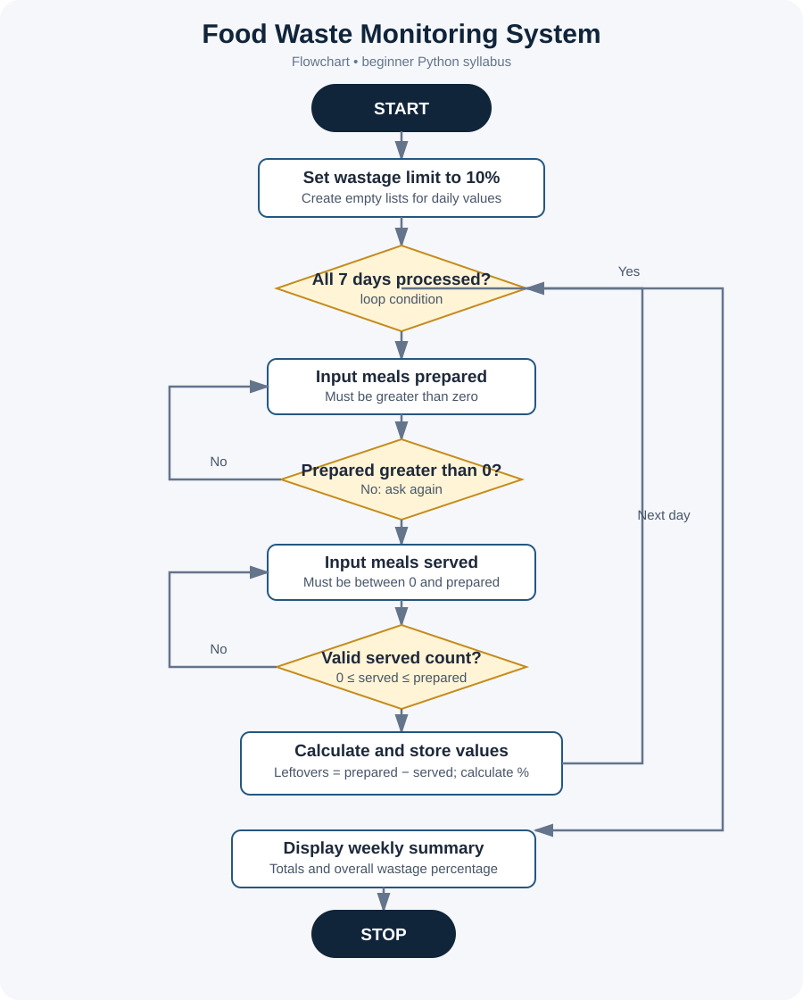

# Project 01: Food Waste Monitoring System

**Case Study:** 53  
**Language:** Python 3

## 1. Problem statement

A canteen may prepare more meals than people eat. This program records meals prepared and served for seven days, calculates leftovers and wastage, and warns when wastage is more than 10%.

## 2. Python topics used

This version uses beginner-level concepts from Units I–III:

- Variables and numeric data types
- Basic input with input() and int()
- Arithmetic and comparison operators
- if-else and logical operators
- for loops with range()
- while loops for value validation
- Lists, indexing, and append()
- Basic output with print()

It does not use imports, user-defined functions, classes, or try-except.

## 3. Objectives and assumptions

- Record prepared and served meals for seven days.
- Calculate leftover meals and wastage percentages.
- Warn when daily wastage is greater than 10%.
- Show weekly totals and overall wastage.
- Input values are whole numbers. Prepared meals must be greater than zero; served meals must be from zero through the prepared count.

## 4. Formula

- Leftover meals = Meals prepared - Meals served
- Wastage percentage = (Leftover meals / Meals prepared) * 100

## 5. Algorithm and pseudocode

See [algorithm-pseudocode.md](algorithm-pseudocode.md).

## 6. Flowchart



Open [flowchart.svg](flowchart.svg) to view it separately.

## 7. Run the program

Open a terminal in this folder and run:

```bash
python food_waste_monitoring.py
```

Enter whole numbers when prompted. The program uses beginner-level validation loops; it expects numeric input and does not handle letters entered where a number is required because exception handling is outside this project's syllabus scope.

## 8. Manual test cases

A compact separate reference is available in [test_cases.md](test_cases.md). Detailed cases are also listed below.

| Prepared | Served | Expected result |
|---:|---:|---|
| 100 | 95 | 5 leftovers, 5% wastage, within limit |
| 100 | 85 | 15 leftovers, 15% wastage, warning |
| 200 | 180 | 20 leftovers, 10% wastage, within limit |
| 50 | 50 | 0 leftovers, 0% wastage |
| 100 | 120 | Rejected; asks for served count again |
| 0 | 0 | Rejected; asks for prepared count again |

For the weekly summary, enter valid values for all seven days.

## 9. Screenshots for submission

Actual terminal screenshots still need to be captured after running the program. Capture:
- One normal result (100 prepared, 95 served)
- One high-waste warning (100 prepared, 85 served)
- The completed seven-day weekly summary

Do not treat the SVG flowchart or sample-output artwork as a terminal screenshot.

## 10. Conclusion

This project practices input/output, variables, arithmetic, conditions, loops, lists, and simple validation to monitor food waste over one week.
