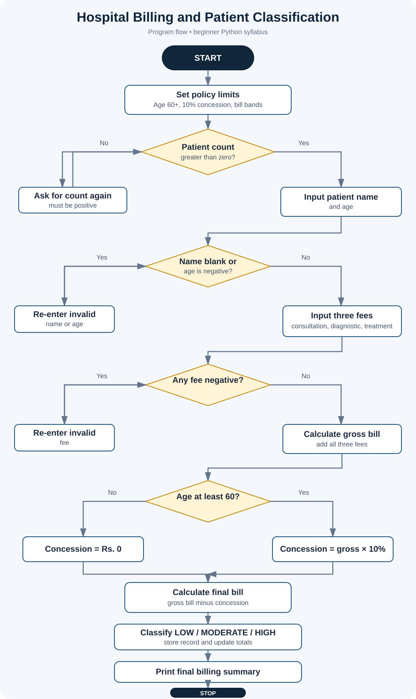

# Project 03: Hospital Billing and Patient Classification

**Case Study:** 3  
**Language:** Python 3

## 1. Problem statement

A hospital needs a simple way to calculate patient bills from consultation, diagnostic, and treatment fees. This program validates the numeric entries, applies a documented senior-citizen concession, classifies each final bill, and prints a summary for all patients entered.

## 2. Objectives

- Calculate a gross bill from three fee components.
- Apply the assumed concession when the patient is 60 years old or older.
- Classify the final bill as LOW, MODERATE, or HIGH.
- Reject negative ages and fees and ask for a valid value again.
- Store patient details in a list of lists and print category totals.
- Practise variables, arithmetic, strings, conditions, loops, and lists.

## 3. Assumptions and payment policy

The case-study description does not specify exact concession percentages or classification bands. For this educational implementation, the following policy is assumed and is not a real hospital policy:

1. Consultation, diagnostic, and treatment fees are entered as whole rupees and cannot be negative.
2. Age is entered in whole years and cannot be negative.
3. Patients aged 60 or older receive a 10% concession on the gross bill.
4. The final bill up to and including Rs. 1,000 is classified LOW.
5. A final bill above Rs. 1,000 and up to and including Rs. 5,000 is classified MODERATE.
6. A final bill above Rs. 5,000 is classified HIGH.
7. A zero fee is allowed. Input is expected to be numeric; exception handling is omitted to stay within the beginner syllabus scope.

## 4. Formulas

- Gross bill = Consultation fee + Diagnostic fee + Treatment fee
- Senior concession = Gross bill × 10 / 100, when age is at least 60
- Final bill = Gross bill − Senior concession

## 5. Algorithm and pseudocode

See [algorithm-pseudocode.md](algorithm-pseudocode.md).

## 6. Flowchart

Open [flowchart.svg](flowchart.svg) separately.

## 7. Run the program

Open a terminal in this folder and run:

~~~text
python hospital_billing.py
~~~

Enter the number of patient bills, then enter a name, age, and the three fees for each patient.

## 8. Test cases

See [test_cases.md](test_cases.md) for the expected outcomes and boundary cases. The program was also run locally using four sample patient records; the results matched the expected bill totals and categories. The visual summary is available at [screenshots/hospital_billing_test_output.svg](screenshots/hospital_billing_test_output.svg). It is a designed summary of a local test run, not a raw terminal screenshot.

## 9. Screenshots for submission

See [screenshots/README.md](screenshots/README.md). Capture a real terminal screenshot on your computer if your faculty requires screenshots of program execution.

## 10. Python concepts used

- Variables and numeric values
- input() and print()
- Arithmetic, comparison, and logical operators
- if, elif, and else
- for and while loops with range()
- Strings and strip()
- Lists, nested lists, append(), and list indexing

The program does not use imports, user-defined functions, classes, or try-except.

## 11. Conclusion

This project demonstrates how to calculate a bill, apply a conditional concession, classify a total using threshold rules, validate values, and summarise multiple records with beginner-level Python.
