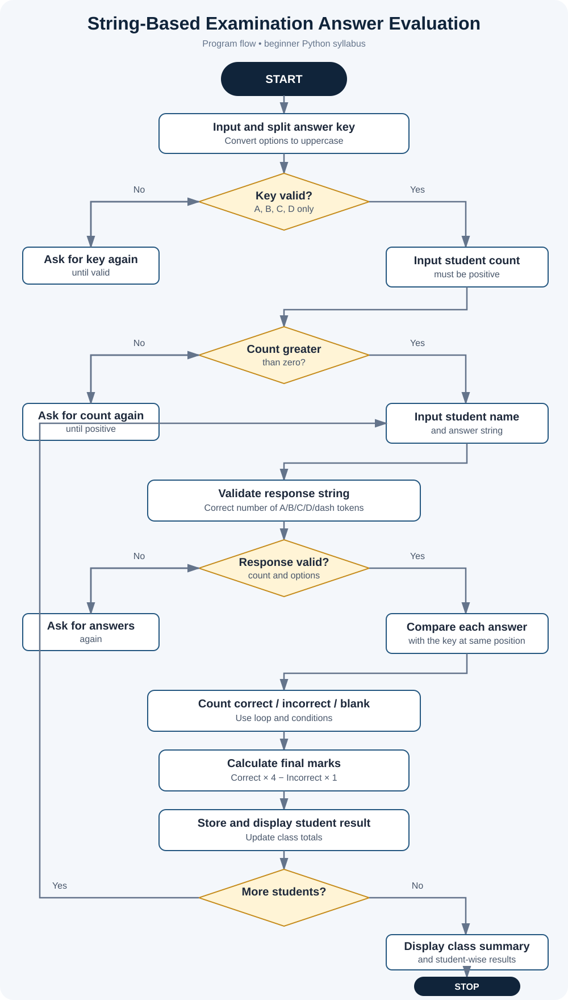

# Project 03: String-Based Examination Answer Evaluation

**Case Study:** 31  
**Language:** Python 3

## 1. Problem statement

Teachers need to compare students' answers with an answer key. This program accepts an answer key and the answers of multiple students, counts correct, incorrect, and unanswered questions, applies negative marking, and prints each student's result and a class summary.

## 2. Objectives

- Compare student answer strings against an answer key.
- Count correct, incorrect, and unanswered responses.
- Apply marks for correct responses and a penalty for incorrect responses.
- Accept a dash (-) to represent an unanswered question.
- Validate the number and format of answers.
- Display student-wise results and overall totals.

## 3. Assumptions and marking rules

The case-study description does not specify a marking scheme, so this project uses the following clearly stated classroom assumptions:

1. Each answer is entered as A, B, C, or D.
2. Answers are entered as space-separated values, for example: A B C D A.
3. Use a dash (-) for an unanswered question.
4. Letter case does not matter; lowercase inputs are converted to uppercase.
5. Every correct answer earns 4 marks.
6. Every incorrect answer receives a penalty of 1 mark.
7. An unanswered question receives 0 marks.
8. A student's answer list must contain exactly the same number of responses as the answer key.
9. The program expects numeric input where a number is requested. try-except is not used so the project stays within the beginner-level syllabus scope.
10. These rules are demonstration assumptions and can be changed if a teacher provides a different marking scheme.

## 4. Formula

- Correct answers = number of responses equal to the answer key
- Incorrect answers = valid A/B/C/D responses that differ from the answer key
- Unanswered questions = number of dash (-) responses
- Final marks = (Correct answers × 4) − (Incorrect answers × 1)

A final score can be negative when incorrect answers outnumber correct answers under the assumed marking policy. The program does not clamp negative scores to zero.

## 5. Algorithm and pseudocode

See [algorithm-pseudocode.md](algorithm-pseudocode.md).

## 6. Flowchart

Open [flowchart.svg](flowchart.svg) to view it separately.

## 7. How to run

Open a terminal in this folder and run:

~~~text
python string_based_exam_evaluation.py
~~~

First, enter the answer key separated by spaces. Then enter the number of students. For each student, enter their name and one answer per question. Use a dash (-) for a empty answer.

## 8. Test cases and sample output

See [test_cases.md](test_cases.md). Three sample students are used for the standard test. The program's output for those sample inputs was checked locally; the expected scores are 20, 11, and 1, for a combined score of 32.

The file [screenshots/exam_evaluation_test_output.svg](screenshots/exam_evaluation_test_output.svg) is a designed summary of the tested output, not a raw screenshot of a terminal. See [screenshots/README.md](screenshots/README.md) for instructions to capture genuine screenshots after running the program on your computer.

## 9. Python concepts used

- Variables and numeric values
- Strings and string methods: upper(), split(), and strip()
- Lists and nested lists
- List indexing and append()
- Arithmetic, comparison, and logical operators
- if, elif, and else
- for and while loops with range()
- Input with input() and output with print()

The program does not use imports, user-defined functions, classes, external packages, or try-except.

## 10. Conclusion

This project shows how answer strings can be compared with a key using loops and conditions. It calculates correct, incorrect, and unanswered counts, applies a negative-marking rule, and produces clear student-wise and overall results using beginner-level Python.
