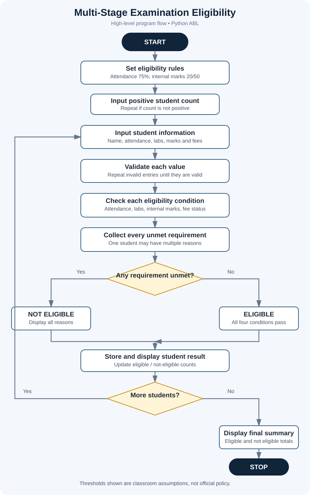

# Project 04: Multi-Stage Examination Eligibility System

**Case Study:** 39  
**Language:** Python 3

## 1. Problem statement

Before a student can appear for a final examination, an institution may need to check attendance, laboratory completion, internal assessment marks, and fee clearance. This program checks these requirements for multiple students and reports whether each student is eligible. For students who are not eligible, it lists every requirement that has not been met.

## 2. Objectives

- Check attendance against a minimum threshold.
- Check whether all required laboratory activities are completed.
- Check internal marks against a minimum score.
- Check whether required fees are cleared.
- Report all unmet requirements, not only the first one.
- Summarise how many students are eligible and not eligible.

## 3. Assumptions and eligibility rules

The case-study description does not specify exact thresholds. This educational implementation uses these documented assumptions, which must be changed if faculty provides a different policy:

1. Minimum attendance is 75%.
2. All required laboratory activities must be completed.
3. Internal assessment must be at least 20 marks out of 50.
4. Required fees must be cleared.
5. A student is eligible only when all four requirements are met.
6. Attendance must be a whole-number percentage from 0 through 100.
7. Internal marks must be a whole number from 0 through 50.
8. Laboratory completion and fee status are entered as Y or N; lowercase y/n is also accepted.
9. Numeric prompts expect numeric input. Exception handling is omitted to remain within the beginner-level syllabus scope.

**These are sample academic rules, not an official university policy.** Confirm the actual thresholds with your faculty before treating the result as an official eligibility decision.

## 4. Decision logic

A student is eligible when all of the following are true:

- Attendance is at least 75%.
- Laboratory activities are completed.
- Internal marks are at least 20 out of 50.
- Required fees are cleared.

The program checks each condition independently, so one student can receive more than one reason for being not eligible.

## 5. Algorithm and pseudocode

See [algorithm-pseudocode.md](algorithm-pseudocode.md).

## 6. Flowchart

Open [flowchart.svg](flowchart.svg) to view it separately.

## 7. How to run

Open a terminal in this folder and run:

~~~text
python eligibility_checker.py
~~~

Enter the student count, then enter each student's name, attendance, laboratory status, internal marks, and fee status.

## 8. Test cases and sample output

See [test_cases.md](test_cases.md). The standard test includes eligible students at and above the assumed thresholds, a student below the attendance threshold, and a student who has incomplete laboratory work and low internal marks.

The file [screenshots/sample_output_preview.svg](screenshots/sample_output_preview.svg) is a designed summary of the standard run, not a raw terminal screenshot. See [screenshots/README.md](screenshots/README.md) for instructions to capture actual terminal screenshots from your computer.

## 9. Python concepts used

- Variables and numeric values
- Input and output using input() and print()
- Strings and methods such as strip() and upper()
- Arithmetic, comparison, and logical operators
- if, elif, and else
- for and while loops with range()
- Lists, nested lists, append(), and list indexing

The program does not use imports, user-defined functions, classes, external packages, or exception handling.

## 10. Conclusion

This project demonstrates how several academic conditions can be checked independently and combined into one eligibility decision. It practises conditions, loops, lists, input validation, and clear explanation of unmet requirements using beginner-level Python.
