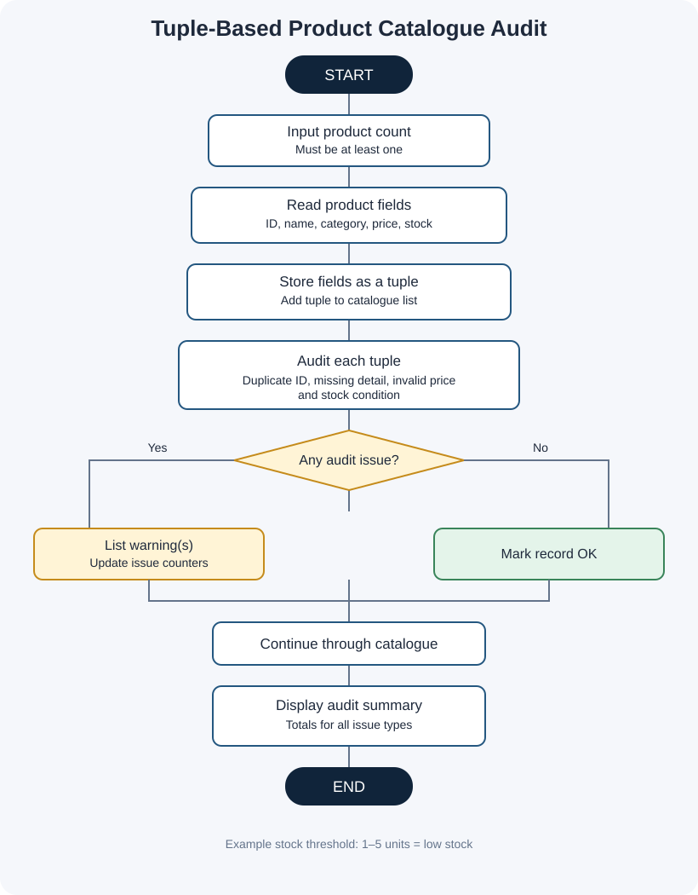

# Project 05: Tuple-Based Product Catalogue Audit

**Case Study:** 49  
**Language:** Python 3

## 1. Problem statement

A small shop needs to review its product catalogue for repeated product IDs, missing names or categories, invalid prices, and stock problems. This program stores every product as a tuple and produces a simple audit report.

## 2. Objectives

- Store product details in tuples inside a list.
- Access tuple values using indexes.
- detect duplicate product IDs by comparing records.
- Find missing details, prices that are zero or negative, negative stock, out-of-stock products, and low-stock products.
- Display each record's audit status and a summary.

## 3. Product tuple format

Each product is stored in this order:

~~~text
(product ID, product name, category, price, stock quantity)
~~~

## 4. Assumptions and audit rules

These are demonstration rules because no specific shop policy was supplied:

1. Product IDs should be unique.
2. Product name and category should not be blank.
3. Price must be greater than zero.
4. Negative stock is invalid.
5. Stock equal to zero is reported as out of stock.
6. Stock from 1 through 5 units is reported as low stock.
7. Numeric fields must be entered as valid numbers.
8. This is an educational audit; it does not change or delete any catalogue data.

The low-stock threshold can be changed by editing `low_stock_limit` near the beginning of the program.

## 5. Algorithm and pseudocode

See [algorithm-pseudocode.md](algorithm-pseudocode.md).

## 6. Flowchart

Open [flowchart.svg](flowchart.svg) to view it separately.

## 7. How to run

Open a terminal in this folder and run:

~~~text
python tuple_product_catalogue_audit.py
~~~

Enter the number of products, then provide the ID, name, category, price, and stock quantity for each product.

## 8. Test cases and sample output

See [test_cases.md](test_cases.md). The file [screenshots/sample_output_preview.svg](screenshots/sample_output_preview.svg) is a designed sample-output preview, **not** a raw terminal screenshot. See [screenshots/README.md](screenshots/README.md) for instructions to capture genuine screenshots after running the program.

## 9. Python concepts used

- Input and output with `input()` and `print()`
- Variables and numeric types
- Tuples and lists
- Tuple indexing and list `append()`
- `if`, `elif`, and `else`
- `for` and `while` loops
- Comparison and logical operators
- String methods and joining text

No imports, user-defined functions, classes, external packages, or `try-except` are used.

## 10. Conclusion

This project demonstrates how tuples can keep each product's details grouped together while loops and conditions help audit the catalogue. It gives staff a clear list of records that need review without silently changing the original data.
