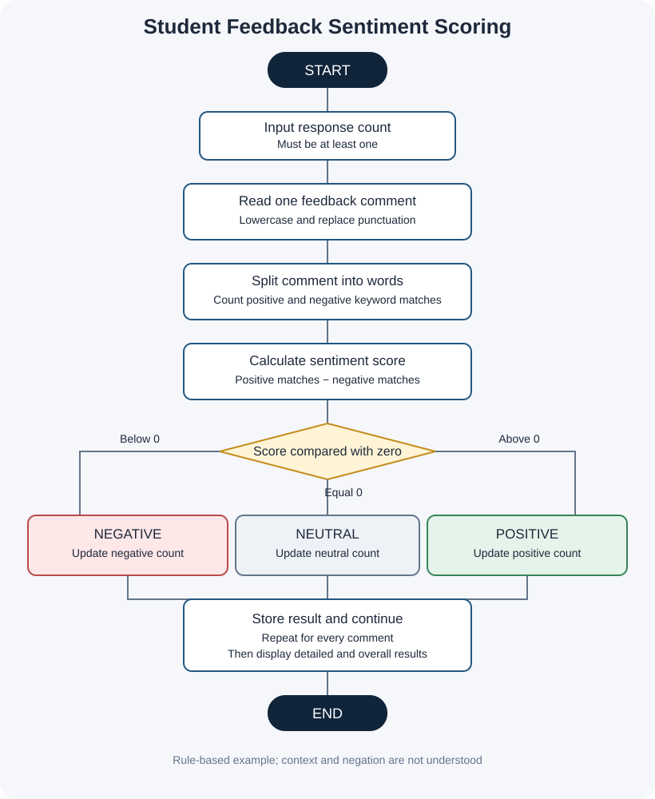

# Project 06: Student Feedback Sentiment Scoring

**Case Study:** 34  
**Language:** Python 3

## 1. Problem statement

A class may collect written feedback about lessons, teaching materials, and learning activities. This beginner-level program looks for selected positive and negative words in each comment, calculates a simple score, and classifies the comment as positive, negative, or neutral.

## 2. Objectives

- Accept multiple short feedback comments.
- Convert text to lowercase and split it into words.
- Count matches from positive and negative keyword lists.
- Calculate a score for every comment.
- Display individual classifications and an overall summary.
- Practise strings, lists, tuples, loops, conditions, and counters.

## 3. Scoring rule and assumptions

This is a simple classroom demonstration, not a full natural-language AI system.

1. Each word in the positive list adds 1 to the score.
2. Each word in the negative list subtracts 1 from the score.
3. Score = positive keyword matches − negative keyword matches.
4. A score above 0 is POSITIVE; below 0 is NEGATIVE; equal to 0 is NEUTRAL.
5. Matching is case-insensitive. Basic punctuation is replaced with spaces before splitting.
6. The keyword lists are examples and may be edited for the topic.
7. The program expects at least one feedback response and valid numeric input for the count.
8. The program does not understand context, sarcasm, or negation. For example, “not good” may still match “good.” Human review is necessary before drawing conclusions.

## 4. Algorithm and pseudocode

See [algorithm-pseudocode.md](algorithm-pseudocode.md).

## 5. Flowchart

Open [flowchart.svg](flowchart.svg) to view it separately.

## 6. How to run

Open a terminal in this folder and run:

~~~text
python student_feedback_sentiment_scoring.py
~~~

Enter the number of responses and then type one comment at each prompt.

## 7. Test cases and sample output

See [test_cases.md](test_cases.md). The file [screenshots/sample_output_preview.svg](screenshots/sample_output_preview.svg) is a designed sample-output preview, **not** a raw terminal screenshot. See [screenshots/README.md](screenshots/README.md) for instructions to capture genuine terminal screenshots after running the program.

## 8. Python concepts used

- Strings and syllabus-listed methods: `lower()`, `replace()`, and `split()`
- Lists and tuples, including tuple concatenation with `+`
- Membership checks using `in`
- Variables and counters
- `if`, `elif`, and `else`
- `for` and `while` loops
- Arithmetic, input, and output

No imports, user-defined functions, classes, external packages, or `try-except` are used.

## 9. Limitations

The program uses an editable list of keywords rather than a trained language model. It counts words rather than understanding full sentence meaning, so results should be treated as a learning exercise and not used to judge individual students.

## 10. Conclusion

This project demonstrates a basic rule-based way to summarize student comments with string processing and loops. It shows how clearly defined rules can turn text into simple counts and categories, while also highlighting why automated sentiment scores need context and human interpretation.
