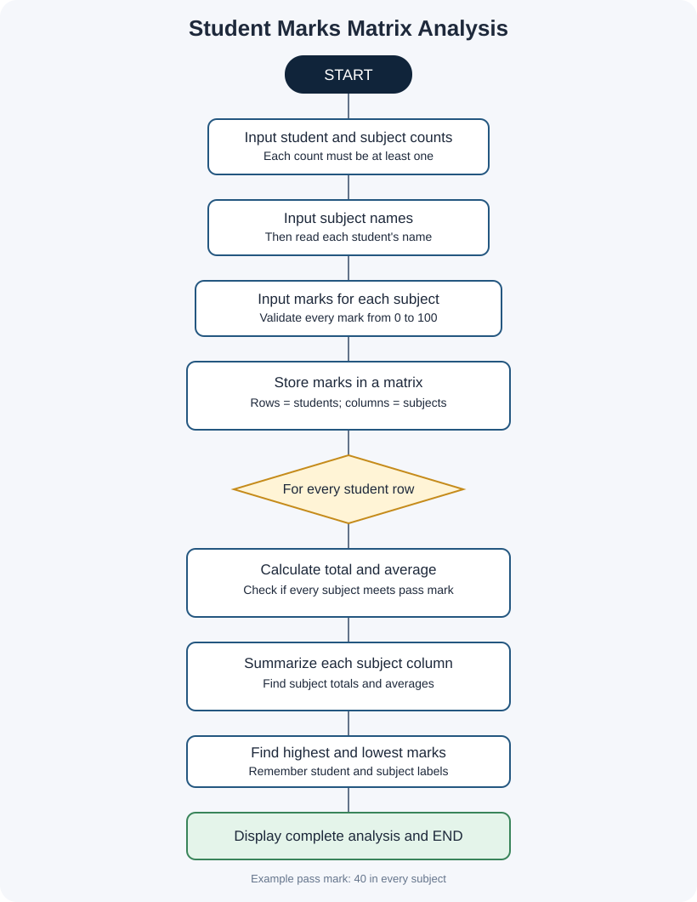

# Project 07: Student Marks Matrix Analysis

**Case Study:** 42  
**Language:** Python 3

## 1. Problem statement

A teacher needs a clear way to review marks for several students across several subjects. This program stores marks in a two-dimensional list (matrix), calculates each student's total and average, summarizes each subject, and identifies the highest and lowest individual marks.

## 2. Objectives

- Store student marks in a matrix (list of lists).
- Use row and column indexes to access a student's mark in a subject.
- Calculate student totals and averages.
- Calculate subject totals and averages.
- Count students who pass all subjects under the example rule.
- Find the highest and lowest individual marks with the associated student and subject.

## 3. Matrix structure

- Each row represents one student.
- Each column represents one subject.
- `marks_matrix[i][j]` stores the marks for student `i` in subject `j`.

## 4. Assumptions and rules

These are classroom demonstration rules, not an official institutional grading policy:

1. Marks for each subject are from 0 to 100.
2. The example pass mark is 40 in every subject.
3. A student passes only if the mark in every subject is at least 40.
4. Student and subject names cannot be blank.
5. The program expects valid numeric input when a number is requested.
6. Marks are entered as numbers; decimals are accepted.
7. Equal highest or lowest marks are reported using the first occurrence found by the matrix scan.

Confirm the actual pass mark and assessment method with faculty before using this program for real results.

## 5. Algorithm and pseudocode

See [algorithm-pseudocode.md](algorithm-pseudocode.md).

## 6. Flowchart

Open [flowchart.svg](flowchart.svg) to view it separately.

## 7. How to run

Open a terminal in this project folder and run:

~~~text
python student_marks_matrix_analysis.py
~~~

Enter the student count, subject count, subject names, student names, and marks when requested.

## 8. Test cases and sample output

See [test_cases.md](test_cases.md). The file [screenshots/sample_output_preview.svg](screenshots/sample_output_preview.svg) is a designed sample-output preview, **not** a raw terminal screenshot. See [screenshots/README.md](screenshots/README.md) to capture genuine screenshots after running the program.

## 9. Python concepts used

- Variables and input/output
- Two-dimensional lists (matrices)
- Lists, indexing, and `append()`
- Nested `for` loops
- `while` loops for basic validation
- `if`, `else`, comparison, and arithmetic operators
- Formatting numeric output with `format()`

No imports, user-defined functions, classes, external packages, or `try-except` are used.

## 10. Conclusion

This project demonstrates how a marks matrix can be analysed row by row and column by column. It produces both student-wise and subject-wise summaries and shows how nested loops make two-dimensional data easier to process.
