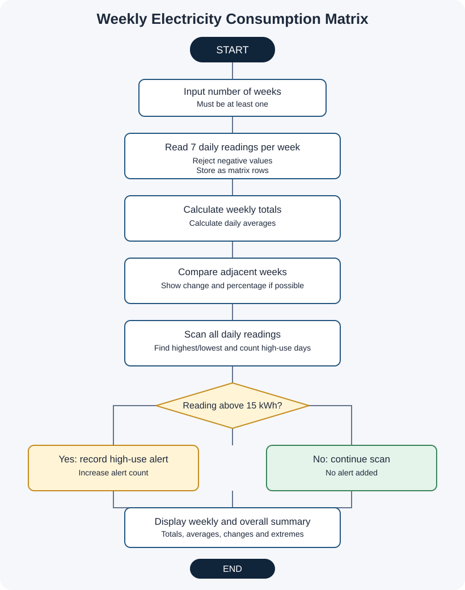

# Project 08: Weekly Electricity Consumption Matrix

**Case Study:** 45  
**Language:** Python 3

## 1. Problem statement

A household or small facility wants to review electricity consumption over several weeks. This program stores daily readings in a two-dimensional matrix, calculates each week's total and daily average, compares weekly totals, and identifies the highest and lowest daily readings.

## 2. Objectives

- Store electricity readings in a matrix with one row per week and seven columns per week.
- Calculate weekly totals and average daily consumption.
- Compare each week with the previous week.
- Calculate percentage changes when the previous week's total is not zero.
- Find the highest and lowest daily readings.
- Count and display days that exceed the example high-use alert limit.

## 3. Matrix structure

- Each row represents one week.
- The seven columns represent Monday through Sunday.
- `consumption_matrix[i][j]` is the kWh reading for the selected week and day.

## 4. Assumptions and rules

These are example project settings, not official power-company rules:

1. Consumption is entered in kilowatt-hours (kWh).
2. Every week contains seven daily readings, Monday through Sunday.
3. Readings must be zero or greater; decimals are accepted.
4. A high-use alert is shown when daily consumption is greater than 15 kWh.
5. Weekly percentage change is calculated as `(current total - previous total) / previous total × 100`.
6. When the previous week's total is zero, the percentage change is not calculated because it would involve division by zero; the program reports this clearly.
7. Numeric prompts expect valid numeric input.

You can adjust `high_usage_limit` near the start of the source file to suit an assignment's requirements.

## 5. Algorithm and pseudocode

See [algorithm-pseudocode.md](algorithm-pseudocode.md).

## 6. Flowchart

Open [flowchart.svg](flowchart.svg) to view it separately.

## 7. How to run

Open a terminal in this project folder and run:

~~~text
python weekly_electricity_consumption_matrix.py
~~~

Enter the number of weeks, then provide seven daily consumption readings for each week.

## 8. Test cases and sample output

See [test_cases.md](test_cases.md). The file [screenshots/sample_output_preview.svg](screenshots/sample_output_preview.svg) is a designed sample-output preview, **not** a raw terminal screenshot. See [screenshots/README.md](screenshots/README.md) to capture genuine screenshots after running the program.

## 9. Python concepts used

- Two-dimensional lists (matrices)
- Variables, numeric values, and formatting
- Lists and indexing
- Nested `for` loops and `while` loops
- `if`, `elif`, and `else`
- Arithmetic, comparison, and logical operators
- Input and output

No imports, user-defined functions, classes, external packages, or `try-except` are used.

## 10. Conclusion

This project demonstrates how a matrix can organize daily readings by week and support useful summaries. Week-by-week totals and comparisons, together with daily high-use alerts, make it easier to spot changing consumption patterns.
