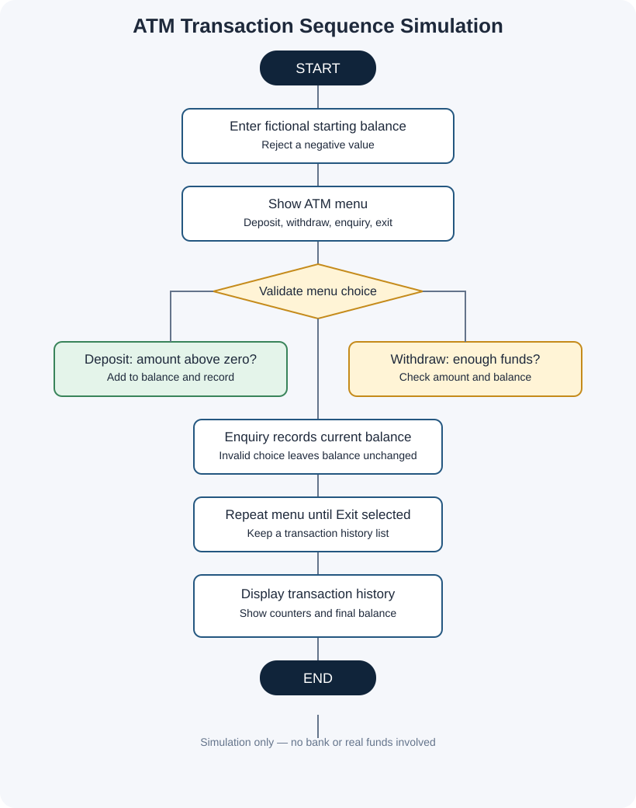

# Project 09: ATM Transaction Sequence Simulation

**Case Study:** 13  
**Language:** Python 3

## 1. Problem statement

An ATM follows a sequence of menu choices for deposits, withdrawals, and balance enquiries. This program simulates that sequence, updates a sample balance, records each transaction or rejected attempt, and prints a session summary.

## 2. Objectives

- Practise a menu-driven program using a `while` loop.
- Simulate deposits, withdrawals, and balance enquiries.
- Prevent withdrawals that exceed the simulated balance.
- Reject zero or negative deposit and withdrawal amounts.
- Store a transaction history in a list.
- Summarize successful and rejected transactions.

## 3. Assumptions and rules

1. This is a learning simulation. It does not ask for a PIN, connect to a bank, contact a payment service, or move real money.
2. The starting balance is a fictional amount entered by the person running the program.
3. Deposits and withdrawals must be greater than zero.
4. A withdrawal greater than the current balance is declined.
5. Balance enquiries are recorded in the transaction history.
6. Invalid menu choices show a warning and do not change the balance.
7. Currency is labelled in Indian rupees (Rs.) for the example; the program is not connected to a real currency or banking system.
8. Numeric prompts expect valid numeric input.

## 4. Algorithm and pseudocode

See [algorithm-pseudocode.md](algorithm-pseudocode.md).

## 5. Flowchart

Open [flowchart.svg](flowchart.svg) to view it separately.

## 6. How to run

Open a terminal in this folder and run:

~~~text
python atm_transaction_sequence_simulation.py
~~~

Enter a simulated starting balance, then choose menu options 1–4 until you choose Exit. Amounts are displayed using Python's default numeric representation (for example, `1300.0`).

## 7. Test cases and sample output

See [test_cases.md](test_cases.md). The file [screenshots/sample_output_preview.svg](screenshots/sample_output_preview.svg) is a designed sample-output preview, **not** a raw terminal screenshot. See [screenshots/README.md](screenshots/README.md) to capture genuine screenshots after running the program.

## 8. Python concepts used

- Variables, strings, and numeric values
- `input()` and `print()`
- `while` and `for` loops
- `if`, `elif`, and `else`
- Lists and `append()`
- Comparisons and arithmetic
- String concatenation with `+` and numeric-to-string conversion with `str()`

No imports, user-defined functions, classes, external packages, or `try-except` are used.

## 9. Conclusion

This project shows how program state changes with a sequence of menu choices. A transaction history and final summary make the steps visible, while balance checks help demonstrate basic validation and conditional logic.
