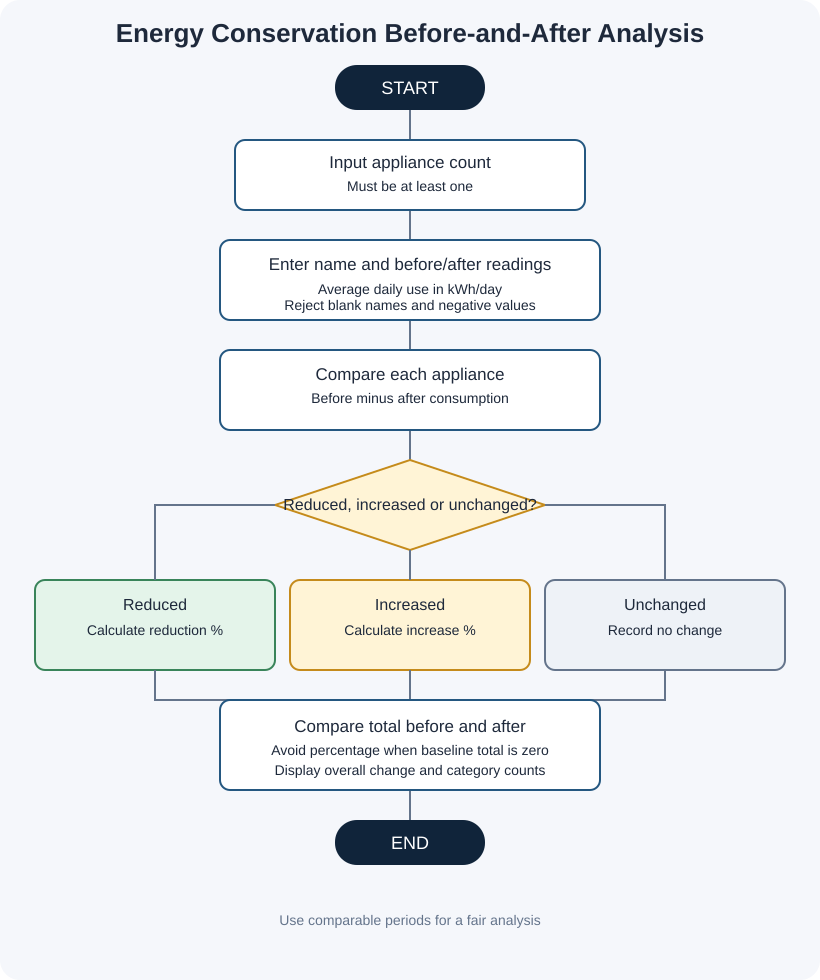

# Project 10: Energy Conservation Before-and-After Analysis

**Case Study:** 68  
**Language:** Python 3

## 1. Problem statement

After making energy-saving changes, a household or small facility wants to compare electricity consumption before and after those changes. This program accepts comparable average daily consumption readings for several appliances, calculates reductions or increases, and summarizes the overall change.

## 2. Objectives

- Record before-and-after consumption for multiple appliances.
- Calculate each appliance's daily reduction or increase.
- Calculate percentage change where the before reading is greater than zero.
- Compare total daily consumption before and after the changes.
- Count appliances with reduced, increased, or unchanged consumption.

## 3. Assumptions and units

1. Every reading is average daily electricity consumption in kilowatt-hours per day (kWh/day).
2. Before and after readings must cover comparable time periods and use the same measurement method.
3. Readings cannot be negative; decimals are accepted.
4. A positive difference (before minus after) means a reduction. A negative difference means consumption increased.
5. When the before reading is zero, that appliance's percentage change is reported as unavailable to avoid division by zero.
6. This program analyses entered values only. It does not connect to a smart meter or prove that an action caused a change.
7. Numeric prompts expect valid numeric input.

## 4. Formulas

- Difference = before consumption − after consumption
- If difference is positive, reduction percentage = difference / before consumption × 100
- If difference is negative, increase = after consumption − before consumption
- Increase percentage = increase / before consumption × 100, when before consumption is greater than zero
- Overall daily change = total before consumption − total after consumption

## 5. Algorithm and pseudocode

See [algorithm-pseudocode.md](algorithm-pseudocode.md).

## 6. Flowchart

Open [flowchart.svg](flowchart.svg) to view it separately.

## 7. How to run

Open a terminal in this folder and run:

~~~text
python energy_conservation_before_after_analysis.py
~~~

Enter the number of appliances and before/after average daily readings for each appliance.

## 8. Test cases and sample output

See [test_cases.md](test_cases.md). The file [screenshots/sample_output_preview.svg](screenshots/sample_output_preview.svg) is a designed sample-output preview, **not** a raw terminal screenshot. See [screenshots/README.md](screenshots/README.md) to capture genuine screenshots after running the program.

## 9. Python concepts used

- Variables, strings, and numeric values
- Lists and indexing
- Input and output
- `for` and `while` loops
- `if`, `elif`, and `else`
- Arithmetic, comparison, and logical operators
- Numeric output formatting

No imports, user-defined functions, classes, external packages, or `try-except` are used.

## 10. Conclusion

This project shows how a consistent before-and-after comparison can summarize energy use across appliances. It makes reductions and increases visible and avoids misleading percentages when a baseline reading is zero.
